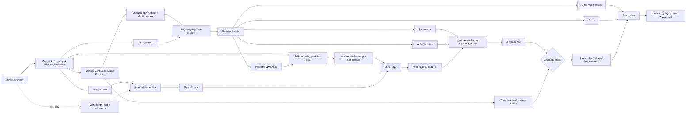

# Near-contact GPro replacement of MonoDETR Z-map

## Experiment being tested

This is a new, isolated ablation. It does not alter the earlier E1 feature-level
or distribution-level implementations.

The question is narrower than “does geometry help the decoder?”:

> If a post-decoder ground-plane estimate is converted to the same KITTI
> bottom-centre depth definition as MonoDETR, does using it in place of the
> sampled dense `Zmap` term improve final depth and AP?

The original Depth Predictor is retained unchanged. Its encoded memory still
feeds the depth cross-attention in the single MonoDETR decoder. Geometry is not
allowed to modify that memory and there is no Pass 2 or learnable fusion alpha.

## Computational graph



The dashed refinement path is hard OpenCV post-processing and is active only in
evaluation. During training, all horizon losses supervise the differentiable
Horizon Head output.

## Near-contact label

For each labelled Car, the generator starts from the four footprint candidates
already used by the GPro3D-style pseudo-label pipeline:

1. Sort candidates by camera-frame `Z` from small to large.
2. Select the two nearest candidates.
3. Average the selected candidates in 3D camera space.
4. Project that 3D midpoint with the full KITTI `P2` matrix.

It is important that step 3 occurs before projection. Averaging two image
pixels would not represent the projection of the 3D midpoint under perspective.

The head is supervised in predicted-box-relative coordinates:

```text
ox = (u_near - x_min) / (x_max - x_min)
oy = (v_near - y_min) / (y_max - y_min)
```

The allowed range is `[-0.20, 1.20]`, so truncated or slightly imperfect boxes
do not force the label into `[0,1]`. The box is detached on this path: the
contact loss trains the ROI contact head and shared visual feature, but cannot
move the 2D box merely to make the offset easier.

The implementation uses a small heatmap and soft-argmax rather than directly
regressing two scalars. This preserves spatial evidence inside the predicted
box while still returning differentiable `(ox, oy)`.

## Why near-edge depth must be corrected

Ray/plane intersection produces the 3D point at the near footprint midpoint,
not the KITTI object location. KITTI evaluates the camera-axis `Z` of the
bottom-centre. Therefore the code reconstructs the same local footprint
candidates using predicted `(width, length, rotation_y)`, selects their two
smallest camera-Z offsets, averages them, and applies:

```text
P_bottom_center = P_near - offset_near(dimensions, rotation_y)
Z_gpro_center   = P_bottom_center.z
```

For the first run, the dimensions/yaw values are detached only on this
correction path. Their normal MonoDETR losses still train them. This prevents a
bad early horizon/contact estimate from improving its own GPro loss by
distorting box dimensions or yaw.

## Depth formula and fallback

The original and new depths are exported together:

```text
Z_baseline = (Z_query + Z_size + Z_map) / 3
Z_cue      = Z_gpro_center if geometry is valid else Z_map
Z_final    = (Z_query + Z_size + Z_cue) / 3
```

No learned alpha can collapse to zero. Invalid geometry is an exact identity
fallback, so those queries reproduce the original scalar formula.

## Losses

The standard MonoDETR classification, box, centre, dimension, angle, depth-map,
and final-depth losses remain enabled. Four new terms are added:

- Horizon heatmap focal loss.
- Horizon slope/intercept Smooth L1 loss.
- Near-contact Smooth L1 loss in box-relative `(ox, oy)` coordinates.
- Direct Smooth L1 loss between `log(Z_gpro_center)` and `log(Z_gt)` on valid,
  matched Cars.

The standard final-depth loss also supervises the replaced formula. Direct
GPro supervision is necessary: without it, `Zquery` and `Zsize` could compensate
for a systematically bad geometry cue and hide that failure in the final mean.

## Files added

- `generate_near_gpro_pseudo_labels.py`: produces the new near-centre label.
- `lib/datasets/kitti/near_gpro_dataset.py`: transforms it into the network
  frame and computes the box-relative target.
- `lib/models/monodetr/near_gpro_zmap.py`: single-decoder model, ROI head,
  centre correction, replacement formula, and criterion.
- `lib/helpers/near_gpro_runtime.py`: target plumbing and detailed inference
  artifacts.
- `tools/train_val_near_gpro.py`: dedicated train/eval entry point.
- `tools/evaluate_near_gpro_depth.py`: branch-level and paired report.
- `configs/near_gpro_zmap_replace_scratch.yaml`: scratch-detector experiment.

## Commands

Generate labels with exactly the same `k_l` and `k_w` as the config:

```bash
python3 generate_near_gpro_pseudo_labels.py \
  --dataset-root data/KITTIDataset --split train \
  --output outputs/near_gpro_pseudo_labels/train.jsonl \
  --k-l 0.65 --k-w 0.85

python3 generate_near_gpro_pseudo_labels.py \
  --dataset-root data/KITTIDataset --split val \
  --output outputs/near_gpro_pseudo_labels/val.jsonl \
  --k-l 0.65 --k-w 0.85
```

Train from scratch (ImageNet initialization of ResNet-50 is retained, as in the
previous scratch-detector run):

```bash
python3 tools/train_val_near_gpro.py \
  --config configs/near_gpro_zmap_replace_scratch.yaml \
  --env-file .env
```

Export one checkpoint:

```bash
python3 tools/train_val_near_gpro.py \
  --config configs/near_gpro_zmap_replace_scratch.yaml \
  --env-file .env --evaluate-only \
  --checkpoint-path outputs/near_gpro_zmap_scratch/near_gpro_zmap_replace_scratch/checkpoint_best.pth
```

Create the detailed report:

```bash
python3 tools/evaluate_near_gpro_depth.py \
  --artifact-dir outputs/near_gpro_zmap_scratch/near_gpro_zmap_replace_scratch/outputs/artifacts \
  --pseudo-labels outputs/near_gpro_pseudo_labels/val.jsonl \
  --output-dir outputs/near_gpro_zmap_scratch/near_gpro_zmap_replace_scratch/depth_report
```

## How to decide whether the idea works

Read the report in this order:

1. `formula_invariants` must be approximately zero. Otherwise the exported
   terms do not correspond to the claimed formula and no comparison is valid.
2. Check near-touchpoint pixel error and `gpro_center` coverage. Low MAE on very
   few valid objects is not a useful cue.
3. On `paired_gpro_valid`, `GPro − Zmap AE` should be negative. This isolates
   cue quality on the exact same detected objects.
4. `Final − baseline AE` should also be negative. If step 3 passes but step 4
   fails, the cue itself is useful but the fixed three-way integration is not.
5. Finally inspect KITTI AP3D R40 Moderate. Depth improvement without AP gain
   can still be offset by box, dimension, orientation, score, or recall errors.

During training, the most useful W&B curves are
`metrics/near_touchpoint_mae_px`, `metrics/gpro_center_mae_m`,
`metrics/gpro_valid_matched_ratio`, the two horizon errors, final validation
depth, recall, and AP3D. There is intentionally no fusion-alpha curve in this
experiment.
