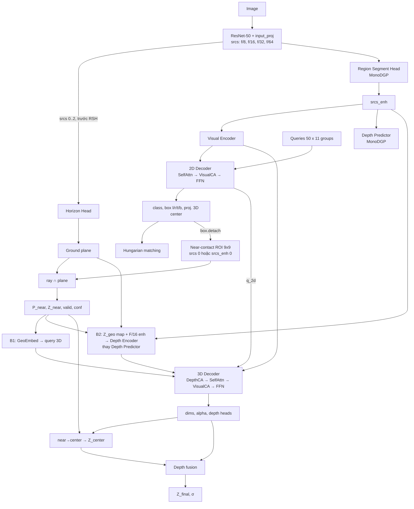

# MonoDGP + GPro near-contact depth

Trạng thái: **đề xuất thiết kế** (chưa implement).

Baseline: **MonoDGP** (CVPR 2025, xây trên MonoDETR; KITTI val Car Mod 22.34
theo paper, 22.5–22.7 theo log của repo). Các module GPro hiện có trong repo này
(`HorizonHead`, `NearContactROIHead`, ray–plane, near→center, dataset
`near_gpro_dataset.py`) được port sang.

Quyết định đã chốt:

1. Dùng nguyên **decoupled query** của MonoDGP: 2D decoder (chỉ visual) khởi tạo
   query cho 3D decoder.
2. Sau 2D decoder chỉ tính **Z_near** (ray ∩ ground plane tại near-contact point).
3. Sau 3D decoder (đã có dims + orientation) mới tính **Z_center** từ Z_near.
4. Final depth: **`Z_final = Z_center + Z_err`** (F1, anchor + error kiểu MonoDGP);
   fallback `f·H/h_bbox + Z_err'` khi GPro không hợp lệ. Gradient của final depth
   **chảy ngược về Z_near**. Fusion nhiều cue (F2) chỉ còn là ablation D6.
5. Horizon Head đặt **song song với RSH**, dùng feature **trước** RSH.
6. Thử **cả hai** cách đưa Z vào 3D decoder: **B1** (query-level, giữ Depth
   Predictor) và **B2 = B2c-vis** (bỏ hẳn Depth Predictor; depth memory được
   encode từ dense geometric depth map `Z_geo` + F/16 enhanced feature).

---

## 0. Động cơ

- Ở các run `near_gpro_zmap_*`: MAE của GPro trên object hợp lệ thấp hơn nhiều
  so với Z-map của Depth Predictor, nhưng AP3D R40 Mod (best ≈ 15, chưa bật aug)
  vẫn dưới MonoDETR.
- MonoDGP đã cho thấy:
  - tách 2D decoder giúp ~+0.9 AP (w/o decoupled query: 21.48 vs 22.34);
  - **một anchor hình học + một error học được** (22.34) tốt hơn **fusion có
    trọng số 3 depth** (21.64).
- Anchor hình học của MonoDGP là `f·H / h_bbox` — phụ thuộc chiều cao 2D box, dễ
  sai khi bị che khuất / cắt mép. **Đóng góp đề xuất: thay/bổ sung anchor đó bằng
  anchor từ mặt phẳng đất** (horizon → plane → near-contact → Z_near → Z_center).

Giới hạn vật lý: `Z = f·h / (v − v_h)` ⇒ `|dZ/dv| = Z²/(f·h)`. Với f≈721,
h=1.65: **0.34 m/px ở 20 m, 1.35 m/px ở 40 m**. GPro mạnh ở gần, yếu ở xa ⇒
anchor phải có fallback / trọng số theo từng object.

---

## 1. Tổng quan



Ký hiệu: `B` batch, `Q` số query (550 khi train = 50 × 11 group, 50 khi eval),
`D = 256`, `H16×W16` = kích thước map stride 16 (24×80 với input 384×1280).

---

## 2. Feature và vị trí các head

| Level | Stride | Nguồn | Dùng bởi |
|---|---|---|---|
| `srcs[0]` | 1/8 | C3 → 1×1 conv + GN | encoder, depth predictor, horizon, ROI |
| `srcs[1]` | 1/16 | C4 → 1×1 conv + GN | encoder, depth predictor, horizon |
| `srcs[2]` | 1/32 | C5 → 1×1 conv + GN | encoder, depth predictor, horizon |
| `srcs[3]` | 1/64 | 3×3 stride-2 conv trên C5 + GN | encoder |

- **Horizon Head**: nhận `srcs[0..2]` **trước RSH**. Lý do: RSH nhân feature với
  xác suất foreground → làm yếu mặt đường, mép đường, cạnh nhà — chính là các
  cue của horizon; và horizon loss không nên backprop vào mask của RSH. Nếu RSH
  ghi đè `srcs` tại chỗ thì phải giữ bản sao trước khi nhân mask.
- **Near-contact ROI**: near-contact nằm ở đáy box (trong vùng RSH làm nổi) →
  có thể hưởng lợi từ `srcs_enh[0]`. Ablation R1: `srcs[0]` vs `srcs_enh[0]`.
- `visual_feature_detach` của horizon / ROI giữ như config hiện tại.

---

## 3. 2D Decoder (giữ nguyên MonoDGP)

```
q ─► SelfAttn (group-split) ─► MSDeformAttn(visual memory) ─► FFN
```

Heads mỗi layer: class, box 6-d (u3d, v3d, l, r, t, b). Output `q_2d`, `box_2d`,
`logits_2d`. Class score cuối cùng của detector đến từ đây (cần xác minh MonoDGP
có re-predict class ở 3D decoder hay không — §12).

---

## 4. Geometry bridge — chỉ tới Z_near

```
box_2d.detach() ─► NearContactROIHead ─► touch_uv (abs, rel), conf_touch
horizon_line ─► plane (n, d = −h)
ray(touch_uv) ∩ plane ─► P_near [B,Q,3],  Z_near = P_near.z
valid_near = ray_valid & plane_valid & in_image & Z_near ∈ [2, 65] m
conf_near  = conf_touch × horizon_conf × ray_stability
```

Không làm near→center ở đây. Box luôn detach trong ROI (depth loss không kéo
2D box ⇒ bảo vệ recall).

---

## 5. Đưa Z vào 3D decoder

Nhắc lại cách MonoDETR/MonoDGP tạo depth memory:

```python
depth_base     = depth_encoder(extract_depth_feature(srcs))   # [B,D,H16,W16] latent visual
weighted_depth = Σ softmax(depth_logits) · bin_values         # [B,H16,W16] depth metric
depth_position = depth_pos_embed.interp(weighted_depth)       # embedding của con số depth
depth_memory   = depth_base + depth_position                  # key/value của Depth CA
```

Thông tin "mét" nằm ở `weighted_depth`. Z_near chỉ là **một giá trị mỗi query**,
nên có hai đường.

### 5.1 B1 — Query-level GeoEmbed

```python
g = depth_pos_embed.interp(clamp(Z_near.detach(), 0, 60))     # cùng bảng embedding 0–60 m
g = g + MLP([conf_near, touch_rel_u, touch_rel_v, log Z_near.detach()])
g = where(valid_near[..., None], g, null_token)               # null_token: nn.Parameter[D]

tgt_3d = LN(q_2d + g)                                          # content
pos_3d = pos_3d_monodgp + g                                    # positional (giữ cách MonoDGP tạo pos)
```

- Depth Predictor + Depth CA của MonoDGP **giữ nguyên**.
- `Z_near.detach()` trong embedding: gradient về Z_near chỉ đi qua fusion (§6),
  không qua attention.

### 5.2 B2 — Dense geometric depth map, thay hẳn Depth Predictor (B2c-vis)

Mặt phẳng đất cho depth ở **mọi pixel**, không chỉ ở touchpoint. B2 dùng nó để
**thay hoàn toàn** Depth Predictor của MonoDGP.

Thêm / bớt so với B1:

| | Block |
|---|---|
| **Bớt** | Depth Predictor (depth head, depth classifier, weighted depth), DDN depth-map loss; nhánh GeoEmbed vào query (chỉ giữ ở bản kết hợp D5) |
| **Thêm** | **Geometric Depth Map** (input: ground plane, box 2D + score detach, Z_near detach → `Z_geo`, `valid_geo`) |
| **Thêm** | **Depth Position Embedding (dense)** trên `Z_geo` |
| **Thêm** | **Depth Feature Projection**: 1×1 conv + GN trên `srcs_enh[1]` (F/16 sau RSH) |
| **Sửa** | **Depth Encoder x1** nhận `Embed(Z_geo) + DepthFeatureProj(srcs_enh[1])`; output là depth memory cho Depth Cross Attention |
| **Sửa** | Depth Cross Attention dùng thêm key padding mask cho vị trí `!valid_geo` (trên horizon) |

Lý do giữ F/16 feature (bản "vis"): depth memory của MonoDETR/MonoDGP là
`latent visual + depth embedding` — vừa có ngoại hình vừa có con số. Chỉ encode
`Embed(Z_geo)` (B2c-pure) thì memory mất phần ngoại hình; giữ làm ablation.

**Bước 1 — ground depth map** (stride 16, tâm pixel trong toạ độ input):

```python
uv     = grid_centers(H16, W16, stride=16)                    # [H16*W16, 2] pixel input
rays   = inv(P[:, :3]) @ [u, v, 1]                             # dùng cùng P2 như ray–plane hiện tại
Z_gnd  = ray ∩ plane                                           # [B,H16,W16]
ground = (denominator ≥ eps) & (distance > 0) & (v > v_horizon(u)) & isfinite
Z_gnd  = clamp(Z_gnd, depth_min, depth_max)
```

Có thể tái dùng `raycast_touchpoints_to_plane` với "touchpoint" là toàn bộ lưới.

**Bước 2 — object splat** (cho pixel thuộc object):

Pixel trên thân xe: tia cắt mặt đất **phía sau** xe ⇒ Z_gnd quá lớn. Bề mặt
nhìn thấy của xe gần với mặt trước ⇒ dùng **Z_near** (không phải Z_center).

```python
# chỉ dùng group 0 khi train (50 query), giống E1 spatial_projection
sel     = valid_near & (sigmoid(logits_2d).max(-1) > τ)        # τ ≈ 0.2, detach
mask_i  = soft_box_mask(box_2d.detach(), softness ≈ 1.25 px@stride16)   # [B,Q,H16,W16]
Z_obj   = min over i of Z_near_i where mask_i > 0.5            # chồng nhau → object gần hơn che
in_obj  = any_i(mask_i > 0.5 & sel_i)
```

**Bước 3 — ghép map và encode (B2c-vis, thiết kế chính):**

```python
Z_geo     = where(in_obj, Z_obj, Z_gnd)                        # [B,H16,W16]
valid_geo = in_obj | ground                                    # trên horizon → False
# plane không hợp lệ (hiếm) → valid_geo = False toàn ảnh, dùng null_depth_token

depth_in     = depth_pos_embed.interp(Z_geo.detach())          # [B,D,H16,W16]
depth_in     = where(valid_geo, depth_in, null_depth_token)
depth_in     = depth_in + DepthFeatureProj(srcs_enh[1])        # phần "vis"
depth_memory = depth_encoder(depth_in, mask = masks[1] | !valid_geo, pos = pos[1])
# Depth Cross Attention của 3D decoder: key/value = depth_memory,
# key_padding_mask = masks[1] | !valid_geo
```

Ablation của B2 (so với B2c-vis):

| Biến thể | Khác biệt | Câu hỏi |
|---|---|---|
| **B2c-pure** | Depth Encoder chỉ nhận `Embed(Z_geo)` | phần ngoại hình trong depth memory có cần không? |
| **B2c-nomask** | Không mask trên horizon; gán `Z = depth_max` | mask vs giá trị cứng |
| **B2-ground** | `Z_geo = Z_gnd`, không splat Z_near vào box | object splat có giúp không? |
| **B2-keepDP** | Giữ Depth Predictor; `Z_geo` thay `weighted_depth` chỉ ở vùng `valid_geo`, phần còn lại dùng `weighted_depth` | có cần bỏ hẳn Depth Predictor không? |

Ghi chú:

- `detach_geo_map: true` (mặc định): map chỉ là input; tắt để Depth CA backprop
  về plane / Z_near (ablation sau).
- Object splat cần `box_2d` và `Z_near` **trước** 3D decoder — khớp với thiết
  kế tách decoder. Depth memory của 3D decoder phải tính sau bridge, không tính
  sẵn như MonoDGP gốc.
- E1 (feature/distribution fusion) từng splat object vào map và không hiệu quả.
  Khác biệt ở B2: (1) mặt đất là cue dày mới; (2) map thay trực tiếp nguồn
  depth thay vì blend với alpha học được. B2-ground tách được đóng góp của
  riêng mặt đất.
- Không còn DDN loss → backbone mất giám sát depth dày. Nếu D4 kém, thử thêm
  lại một `depth_classifier` phụ chỉ để tính DDN loss (cờ
  `keep_depth_classifier_aux`), không dùng làm guidance.

### 5.3 Kết hợp

B1 và B2 độc lập — có thể bật cùng lúc (B1+B2x) làm run cuối.

---

## 6. Near→center và fusion depth

### 6.1 Z_center (sau 3D decoder)

```
ry       = alpha_3d + atan2(u2d_center(box_2d) − cx, fx)
offset   = near_offset(dims_3d, ry; k_l, k_w)                 # _near_offset_camera hiện có
P_center = P_near − offset
Z_center = P_center.z
valid_c  = valid_near & isfinite & Z_center ∈ [2, 65]
```

`detach_pose_in_center: true` (mặc định): dims/yaw detach trên đường này; vẫn học
từ loss_dim / loss_angle.

### 6.2 Fusion

Hai biến thể, cả hai đều có gradient về Z_near qua Z_center:

**F1 — anchor + error (kiểu MonoDGP) — ĐÃ CHỐT làm thiết kế chính:**

```
Z_final = Z_center + Z_err          nếu valid_c
        = f·H/h_bbox + Z_err'       nếu !valid_c   (đúng công thức MonoDGP)
```

`Z_err`, `Z_err'` là hai head riêng (phân bố sai số của hai anchor khác nhau).
Laplacian σ chung cho score. Lựa chọn này dựa trên ablation của MonoDGP
(anchor+error 22.34 > fusion 3 depth 21.64).

**F2 — residual nhiều cue (thiết kế ban đầu, chỉ dùng cho ablation D6):**

```
w = softmax([−s_c, −s_q, −s_s]),  s_* = log σ_* ;  !valid_c ⇒ s_c = +∞
Z_final = Z_center + w_q (Z_query − Z_center) + w_s (Z_size − Z_center)
```

Kèm loss Laplace riêng cho từng cue để σ_* có nghĩa (chống w_c sụp về 0).

### 6.3 Gradient về Z_near

```
F1:  ∂L_final/∂Z_near = ∂L_final/∂Z_final                 (khi valid_c)
F2:  ∂L_final/∂Z_near = w_c · ∂L_final/∂Z_final
+    ∂L_near/∂Z_near   trực tiếp (nhãn near_contact.camera_3d[2])
```

Z_near → touchpoint head và horizon head. Horizon là per-image: mọi object cùng
đẩy horizon ⇒ vẫn giữ horizon loss, theo dõi `horizon_center_mae_px`.

Rủi ro F1: `Z_err` lớn có thể "nuốt" sai số của Z_near ⇒ thêm `loss_near_depth`
trực tiếp và warm-up (§10).

---

## 7. Matching và loss

- Matching: giữ cơ chế MonoDGP (group-wise one-to-many 11 group). Loss GPro
  (touchpoint, L_near) dùng **cùng indices** với loss 3D để cùng một object.
- Box 2D detach ở: ROI, `f·H/h_bbox` trong Z_size/anchor fallback (cờ
  `detach_box_in_size`), reference cho object splat.

| Loss mới | Áp lên | Hệ số đề xuất |
|---|---|---|
| `loss_horizon_heatmap`, `loss_horizon_line` | Horizon head | 1.0, 0.5 |
| `loss_near_touchpoint` (box-relative smooth-L1) | ROI head | 1.0 |
| `loss_near_depth` (log smooth-L1, Z_near vs GT near Z) | Z_near | 1.0 |
| `loss_center_depth` (log smooth-L1, Z_center vs Z*) | Z_center | 0.5 |
| F2: `loss_cue_{c,q,s}` (Laplace) | từng cue | 0.5 |

Giữ nguyên toàn bộ loss MonoDGP (2D, 3D, depth Laplace, RSH Dice, DDN).

---

## 8. Dataset

- Thêm target `near_depth = near_contact.camera_3d[2] × label_depth_factor`
  (`NearGProKITTIDataset._label_depth_factor` đã có). **Không cần gen lại pseudo label.**
- Giữ `depth_consistent_geometry_calib` khi bật crop.
- **Mixup3D** (MonoDGP dùng): cần đọc code. Nếu trộn 2 ảnh khác nhau, nhãn
  horizon/plane của ảnh trộn không duy nhất và object của ảnh phụ đứng trên mặt
  đất khác ⇒ tắt Mixup3D, hoặc chỉ tính loss horizon/GPro cho object thuộc ảnh
  chính, và không dựng B2 ground map từ horizon của ảnh trộn.

---

## 9. Inference

- Class, box 2D, projected center: 2D decoder (xác minh §12).
- Dims, alpha, Z_final: 3D decoder.
- Score = `sigmoid(logits) × exp(−log σ)` như MonoDETR/MonoDGP.
- Export: `Z_near, Z_center, Z_final, Z_err, valid_c` (+ `w_*` cho F2), và
  một ảnh `Z_geo` mẫu cho B2.

---

## 10. Lịch train

| Giai đoạn | Epoch | Thiết lập |
|---|---|---|
| Warm-up | 0 → E_w (≈ 20) | Z_near detach trong fusion. B2: không còn `weighted_depth` để dự phòng ⇒ dựng `Z_geo` bằng **horizon GT và near-touchpoint GT** (teacher forcing, chỉ khi train) với xác suất giảm dần 1 → 0. Z_near học từ L_near / touchpoint / horizon. |
| End-to-end | E_w → hết | Bỏ detach Z_near trong fusion; B2 chỉ dùng horizon / touchpoint dự đoán. |

Eval luôn dùng giá trị dự đoán. Theo dõi khoảng cách AP giữa eval với GT
geometry và eval với predicted geometry để biết độ phụ thuộc của 3D decoder vào
chất lượng map.

Schedule còn lại theo MonoDGP (250 epoch, batch 8, AdamW 2e-4, decay ×0.5 ở
85/125/165/225) — xác nhận lại trong config của họ.

---

## 11. Ablation

| ID | Cấu hình | Câu hỏi |
|---|---|---|
| D0 | MonoDGP gốc (tái lập, ≥ 2 seed) | baseline thật trên máy mình |
| D1 | D0 + horizon + touchpoint + L_near (không đưa vào depth) | multi-task có hại / có lợi không? |
| D2 | D1 + F1 (Z_center anchor), **không** B1/B2 | anchor GPro thay `f·H/h` |
| D3 | D2 + **B1** | thông tin Z_near trong query |
| D4 | D2 + **B2 (B2c-vis)** | thay hẳn Depth Predictor bằng depth map hình học |
| D4-x | D4 với từng ablation B2 ở §5.2 (pure / nomask / ground / keepDP) | thành phần nào của B2 quan trọng |
| D5 | D2 + B1 + B2 tốt nhất | kết hợp |
| D6 | D3 với F2 thay F1 | fusion nhiều cue vs anchor+error |
| R1 | D3 với ROI trên `srcs_enh[0]` | ROI trước / sau RSH |
| R2 | D3 với Z_near detach suốt | backprop về Z_near có giúp không? |

Metric, **trên cùng tập object matched**, theo bin 0–10/10–20/20–30/30–40/40+ m:

- MAE và inlier `|ΔZ| < 0.5 m`, `< 1 m` cho Z_near, Z_center, Z_final, và anchor
  `f·H/h` của MonoDGP.
- Coverage `valid_c` trên matched Car.
- Recall 2D, AP2D, AP3D/BEV R40 Easy/Mod/Hard.
- B2: MAE của `Z_geo` vs `weighted_depth` trên vùng ground và vùng object
  (dùng LiDAR depth nếu có, hoặc depth GT của object trong box).

---

## 12. Cần xác minh trong code MonoDGP trước khi implement

1. RSH gắn ở đâu (sau `input_proj` hay trên C3–C5), có ghi đè `srcs` không.
2. Cách 2D decoder khởi tạo 3D query: tách content/pos thế nào, reference point
   lấy từ đâu, có detach không.
3. 3D decoder có re-predict class/box không; matching dùng output nào.
4. Head `Z_err` và loss depth cụ thể; `f·H/h_bbox` dùng box nào, có detach không.
5. Mixup3D: trộn ảnh nào với ảnh nào, nhãn xử lý ra sao.
6. Config đầy đủ (augmentation, `depth_scale`, schedule).

---

## 13. Kế hoạch implement

| Bước | Nội dung |
|---|---|
| 1 | Clone MonoDGP, tái lập D0 |
| 2 | Port `geometry_e1.py` (horizon, plane, raycast), `NearContactROIHead`, `near_gpro_dataset.py`, `depth_consistent_geometry_calib` |
| 3 | Bridge Z_near + losses (D1) |
| 4 | Near→center sau 3D decoder + F1 (D2) |
| 5 | B1 GeoEmbed (D3) |
| 6 | `GeometricDepthMap` (ground map, object splat, mask) + `DepthFeatureProj` + bỏ Depth Predictor; teacher forcing warm-up (D4) |
| 7 | Tester export + script phân tích theo bin |

Phác thảo config:

```yaml
gpro:
  horizon: {input: pre_rsh, fpn_channels: 128}
  near_touchpoint: {roi_feature: pre_rsh, roi_size: 9, box_detach: true}
  fusion: {mode: F1, detach_pose_in_center: true, detach_box_in_size: true}
  query_embed:                       # B1
    enabled: true
  geo_depth_map:                     # B2
    enabled: false
    replace_depth_predictor: true    # false → B2-keepDP
    visual_feature: true             # false → B2c-pure
    object_splat: true               # false → B2-ground
    mask_above_horizon: true         # false → B2c-nomask
    object_score_threshold: 0.2
    box_softness_px: 1.25
    detach: true
    keep_depth_classifier_aux: false
    teacher_forcing_epochs: 20
  training:
    gpro_backprop_start_epoch: 20
  losses:
    near_depth_loss_coef: 1.0
    center_depth_loss_coef: 0.5
```
